# Harness

A macOS desktop app to run ACP coding Agents (Claude, Codex, OpenCode and others) in one place. ACP (Agent Client Protocol) is an open protocol that lets an app talk to any AI coding Agent.

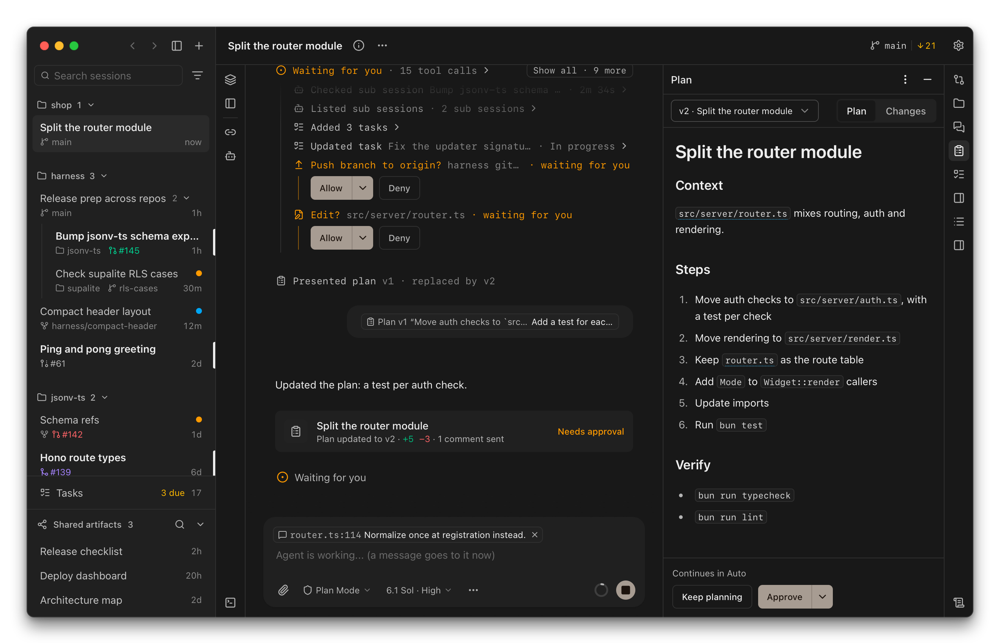

## Why Harness

- **Any ACP Agent in one app.** Install Claude, Codex, OpenCode or a Custom Agent. All Sessions look and work the same.
- **Agents build UI with state for you.** With the `render_ui` tool, an Agent makes panels and cards (forms, charts, quizzes) that keep their own state.
- **Agents can run other Agents.** One Agent can start Sub Sessions in other repositories, send them messages and get their results.
- **A durable Session Log.** The Harness records each Session in its own log. Sessions survive app restarts, and any number of windows can show the same Session.

## Features

### Readable Agent work

Tool calls show as short steps. Permission requests show inline with Allow and Deny, and your Permission Policy rules decide which requests ask you. Plans are versioned: you can comment on a Plan and approve it with Approve.

### Agent-built UI with state

Agents build panels and inline cards from a component catalog: stats, forms, steppers, charts, tables, HTML and SVG, and sandboxed JavaScript. Panels share one Session State, so a change in one panel updates another. A panel can also follow a Markdown or HTML file that the Agent writes. You can rename a panel, change its icon or delete it.

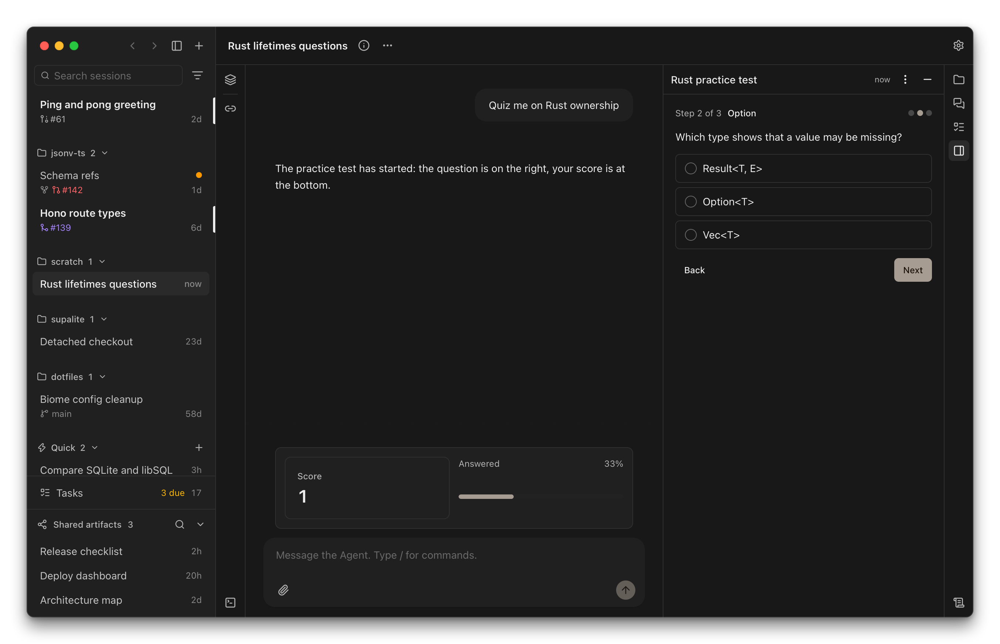

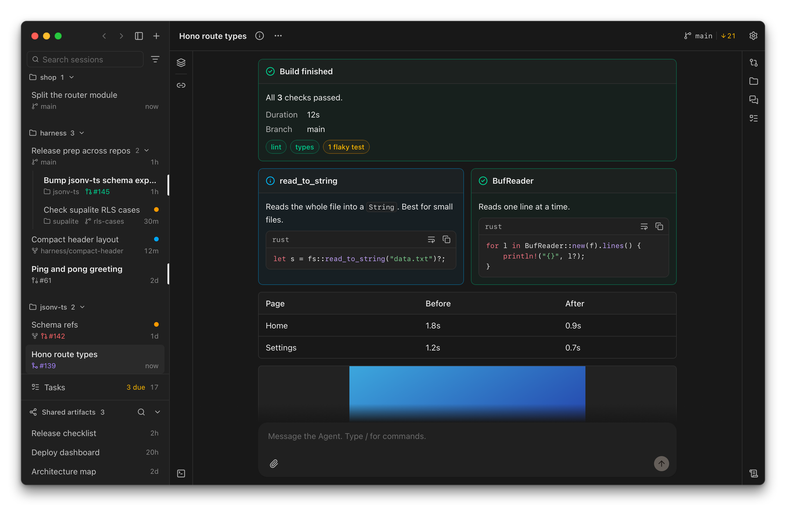

### Sub Sessions

An Agent can start a Sub Session: a full Session with its own Agent, model, effort, folder and branch. The Agent can send it messages and wait for its reply. When the Sub Session finishes a Turn, the Harness tells the parent Agent. Sub Sessions show under their parent in the sidebar.

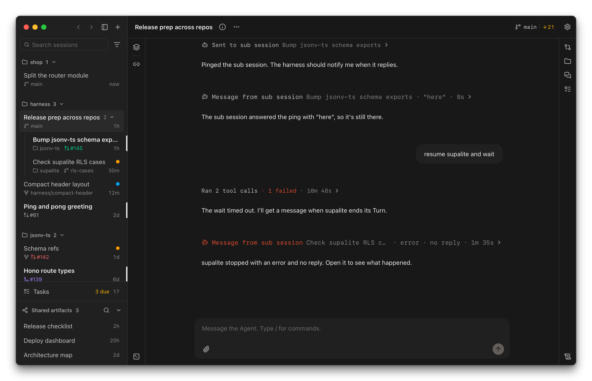

### Side chats

A side chat is a second conversation next to the main chat. It does not change the main chat's context. Start it with the full conversation or with nothing. Each side chat has its own tab, and you can reopen past side chats.

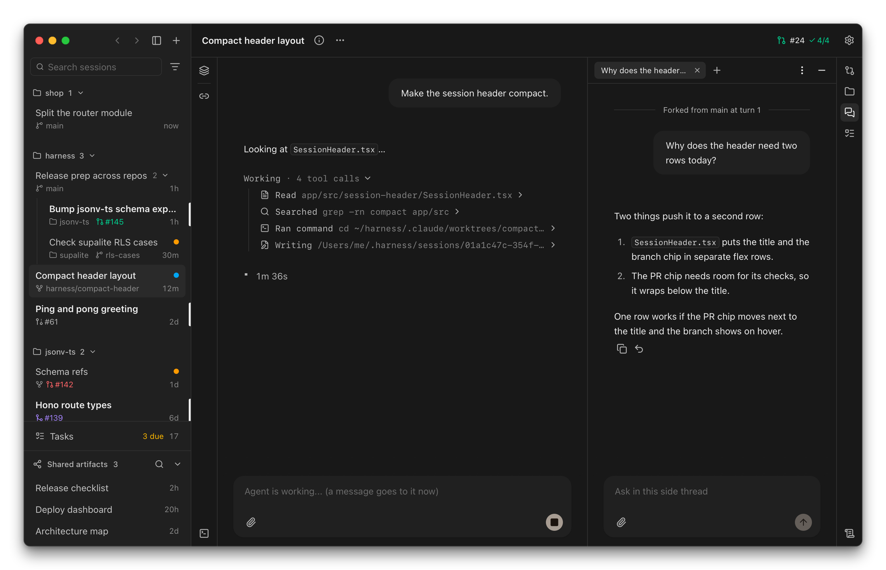

### Sessions, Workspaces and Worktrees

To start a Session, pick a folder, a branch or pull request, and optionally a new Worktree (a separate git checkout only for this Session). A Quick Session needs no folder. The sidebar has search, sort, groups and a marker for Turns you have not seen.

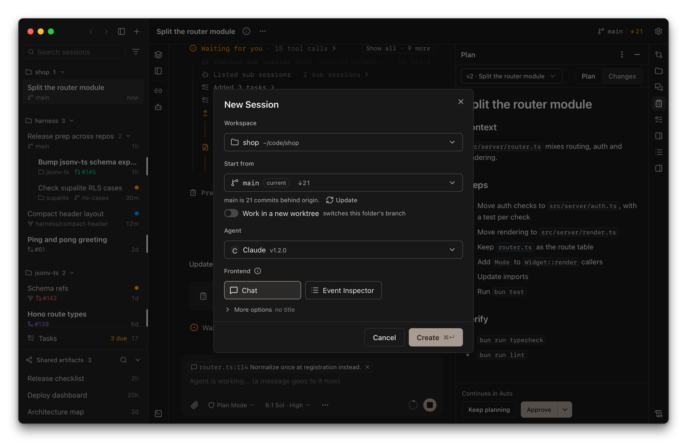

### Review changes

The Changes panel shows the files each Turn changed, and you can push from the Session header. Add Review Comments on diff lines. They stay in the Session Log, and the Agent can read and resolve them. You can also comment on selected text in the chat, in Plans and in artifacts.

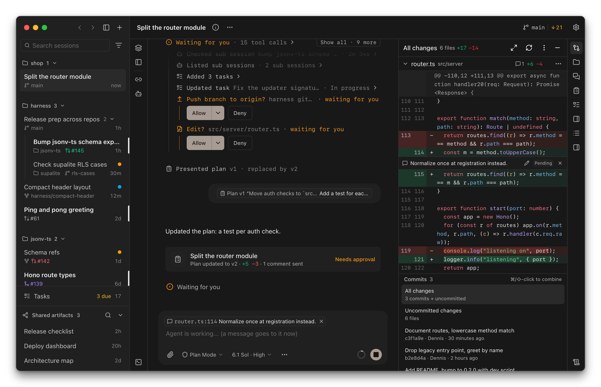

### Full diff window

The diff window has a file tree, side-by-side or unified diffs and the Session's commit list. Cmd-click or Shift-click commits to combine them in one diff. Review Comments show inline.

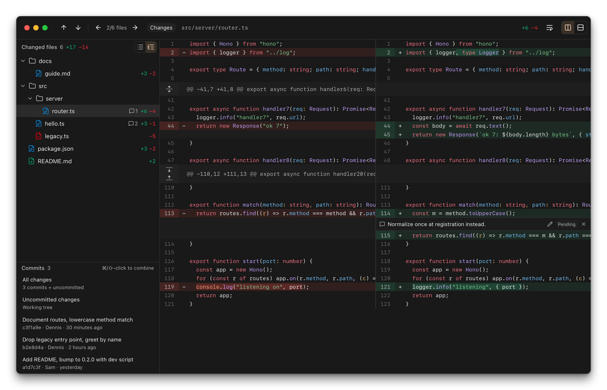

### Pull requests

Start a Session from a pull request. The Session header and the sidebar show the live PR status and checks. References like `owner/repo#123` show as chips, and the prompt box completes them. Agents can open a pull request with the `pr_create` tool.

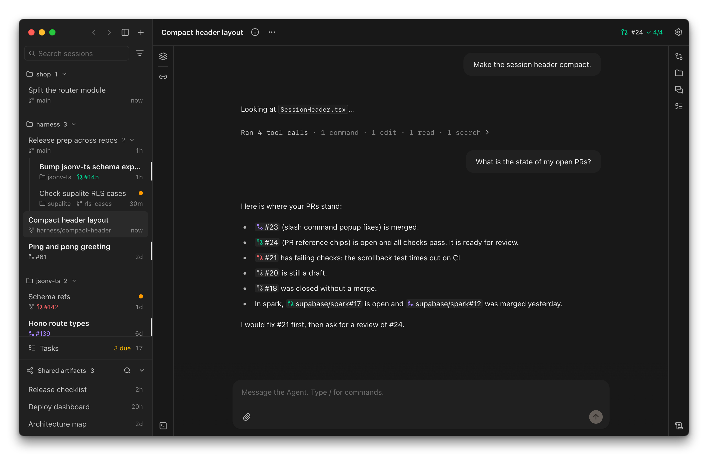

### Artifacts

The Artifacts panel collects what the Agent made: HTML, images, diagrams and tables. Make an artifact shared to use it in other Sessions.

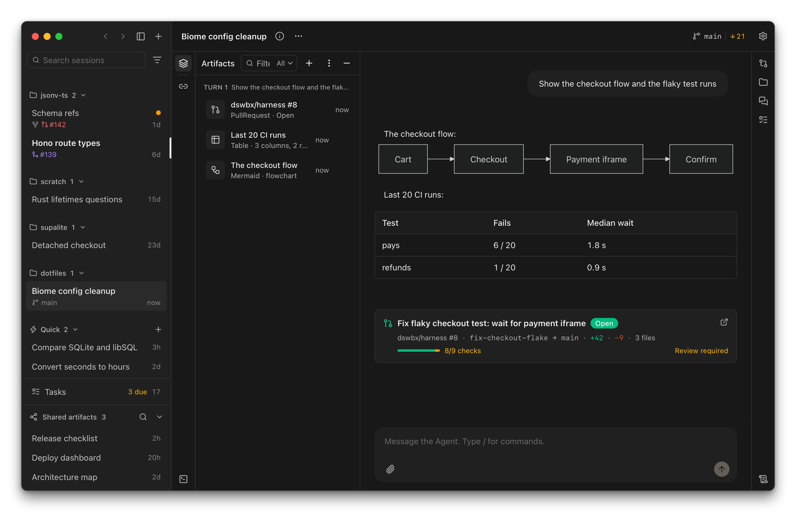

### Tasks and notes

The Agent shows its Task List (its live steps) in the chat. Tasks are your own work items. The Tasks view shows them across all Sessions, and Agents can read and add them. Each Session also has one Markdown note.

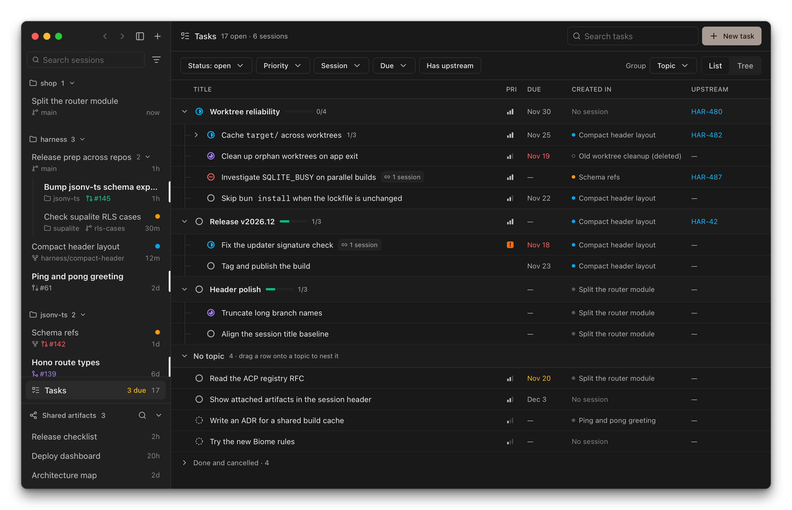

### Terminal, Files and dockable panels

Each Session has its own Terminal (toggle it with Cmd+J). The Files panel lets you browse, preview and comment on files. You can dock each panel in one of six Zones and move it by drag.

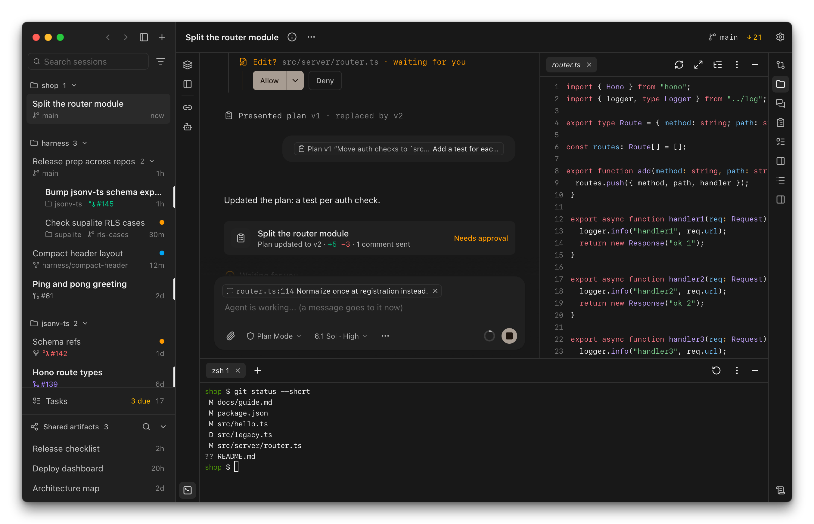

### Quick Overlay

A global shortcut opens a floating chat over any app. It starts a Quick Session and can include what you were looking at, such as the window title or selected text.

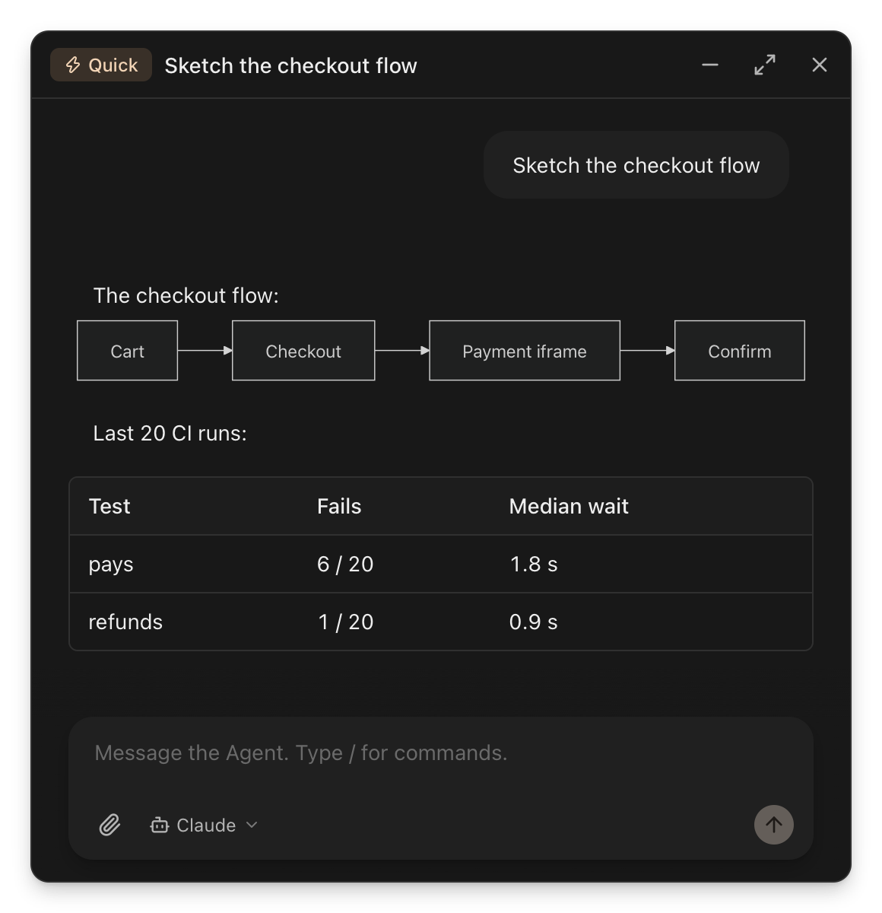

### Agents from the ACP Registry

Install, update and remove Agents from the ACP Registry (the public list of ACP Agents). The Harness runs them on its own toolchain: pinned Node and uv versions, with sha256-checked downloads. You do not need Node or Python on your Mac. You can also add a Custom Agent with any command. Agent sign-in shows in the chat.

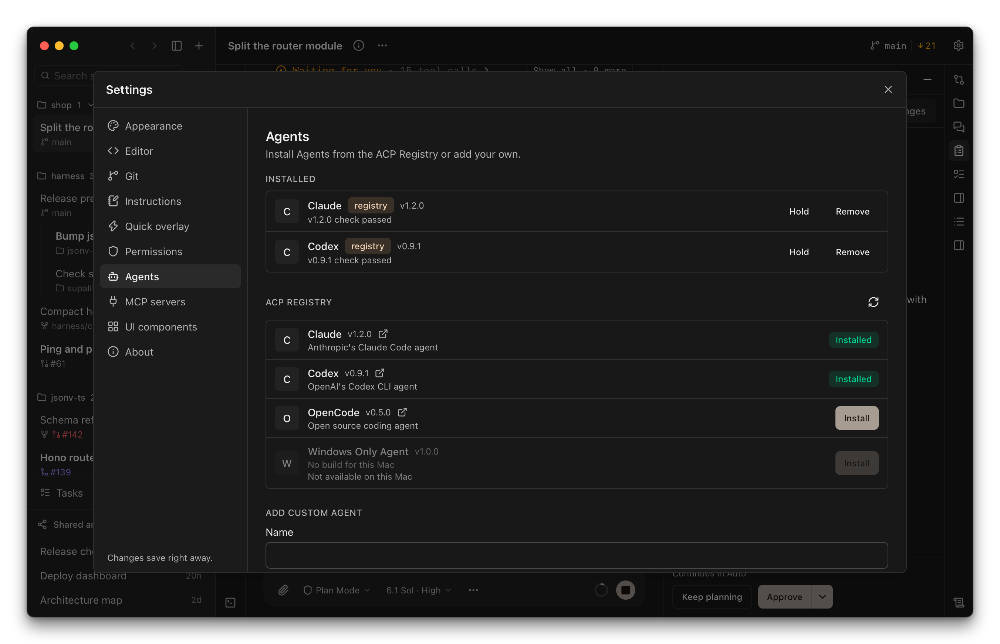

### Make it yours

Pick a theme: the built-in Harness theme or a tweakcn preset, in light or dark. Write Custom Instructions for all Sessions or for one repository. Set Permission Policy rules and Git settings such as the Worktree folder and the branch prefix.

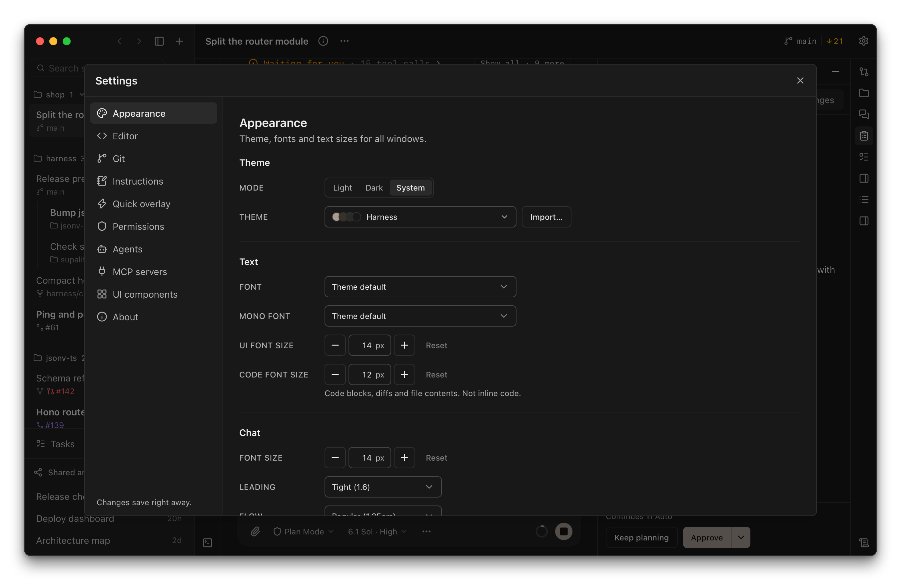

### Also

- A dock badge and notifications when a Session needs you.
- Opt-in updates: the app tells you about a new release and installs it only when you agree.
- MCP Library: add your own MCP servers once and pick them per Session. Secrets stay in the macOS Keychain.
- Harness MCP: the Harness gives every Agent git tools and its Frontend's tools. Agents without HTTP MCP use a stdio shim (`harness mcp-shim`).
- Inspector Frontend: a raw view of the Session Log.
- Back and forward navigation in the app.

## Install

1. Download the `.dmg` from the [latest release](https://github.com/dswbx/harness/releases/latest). It is a universal build for Apple silicon and Intel Macs, and needs macOS 13 or later.
2. Drag Harness to Applications.
3. Release builds are ad-hoc signed and not notarized, so macOS blocks the first open. Open **System Settings → Privacy & Security** and click **Open Anyway**. Or run `xattr -dr com.apple.quarantine /Applications/Harness.app`.

First steps: open **Agents**, install Claude or Codex, click **New Session**, pick a folder and chat. Sign in when the Agent asks.

## How it works

Agents run as separate processes and talk to the Harness over ACP. A Rust core owns the shared parts: Sessions, the Session Log, Workspaces and git, the Permission Policy, Agent installs and the Harness MCP. The core writes every Event of a Session to its Session Log, an append-only JSONL file. Frontends are TypeScript and render only from the Session Log. So the same Session can show as a chat, as a raw event list in the Inspector, or in a new Frontend.

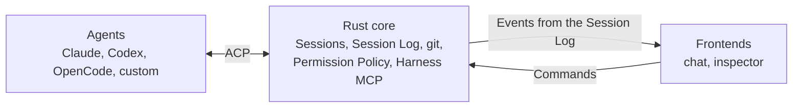

Terms: [GLOSSARY.md](GLOSSARY.md). Decisions: [docs/adr/](docs/adr/).

## Development

You need macOS 13+, Rust (stable), [Bun](https://bun.sh) and git. Run `bun install`, then `bun run dev`. `bun run screenshots` makes the README images again from the browser mock with Playwright.

Layout, tests, release and data folders: [docs/development.md](docs/development.md).
